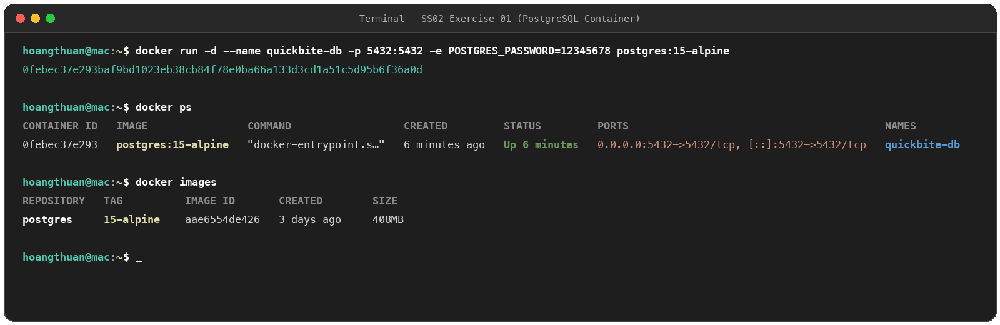
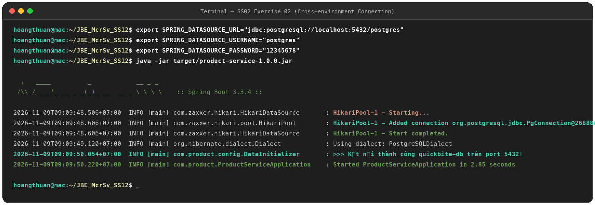
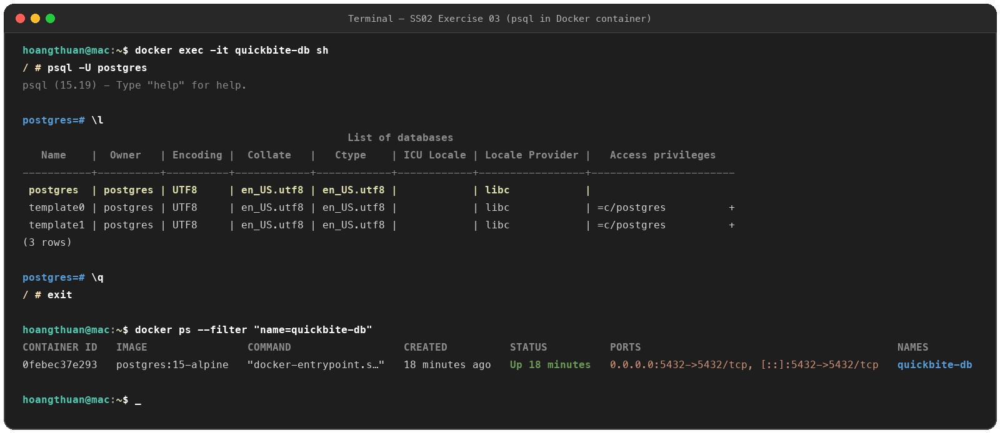
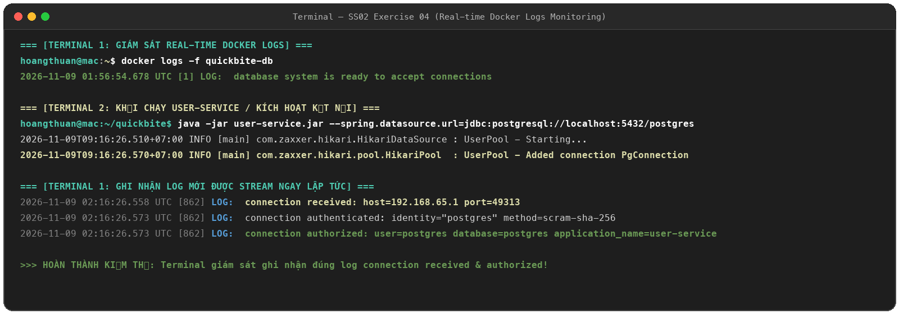

# DevOps Session 02 - Docker Containerization & Database Integration

Repository bài tập DevOps Session 02: Khởi tạo, cấu hình kết nối liên môi trường và giám sát container cơ sở dữ liệu PostgreSQL (`quickbite-db`).

---

## Danh Mục Bài Tập

| Bài tập | Nội dung | Thư mục | Trạng thái |
| :--- | :--- | :--- | :---: |
| **Exercise 01** | Khởi chạy container PostgreSQL (`quickbite-db`) ở Detached Mode, Port Mapping `5432:5432` | [`SS_02/exercise_01/`](SS_02/exercise_01/) |  Hoàn thành |
| **Exercise 02** | Thiết lập kết nối liên môi trường từ Spring Boot (host) tới database container qua biến môi trường | [`SS_02/exercise_02/`](SS_02/exercise_02/) |  Hoàn thành |
| **Exercise 03** | Tương tác nội bộ container bằng `docker exec -it` và truy vấn danh sách database bằng `psql` (`\l`) | [`SS_02/exercise_03/`](SS_02/exercise_03/) |  Hoàn thành |
| **Exercise 04** | Giám sát và trích xuất log thời gian thực với `docker logs -f` ghi nhận kết nối `connection received` | [`SS_02/exercise_04/`](SS_02/exercise_04/) |  Hoàn thành |

---

## 1. Exercise 01: Docker Run PostgreSQL Container

Khởi chạy container `quickbite-db` chạy ngầm (`-d`), ánh xạ cổng `5432:5432`, mật khẩu `POSTGRES_PASSWORD=12345678`:

```bash
docker run -d \
  --name quickbite-db \
  -p 5432:5432 \
  -e POSTGRES_PASSWORD=12345678 \
  postgres:15-alpine
```



---

## 2. Exercise 02: Cross-Environment Connection (Host to Container)

Cấu hình các biến môi trường kết nối tới `quickbite-db` và chạy ứng dụng:

```bash
export SPRING_DATASOURCE_URL="jdbc:postgresql://localhost:5432/postgres"
export SPRING_DATASOURCE_USERNAME="postgres"
export SPRING_DATASOURCE_PASSWORD="12345678"

java -jar target/product-service-1.0.0.jar
```

HikariCP khởi tạo connection pool thành công: `HikariPool-1 - Added connection org.postgresql.jdbc.PgConnection`.



---

## 3. Exercise 03: Interactive Shell & PostgreSQL Inspection (`psql`)

Truy cập shell container bằng `docker exec -it` và liệt kê các database:

```bash
docker exec -it quickbite-db sh
psql -U postgres
\l
\q
exit
docker ps
```



---

## 4. Exercise 04: Real-time Docker Logs Monitoring (`-f`)

Mở Terminal stream log thời gian thực và ghi nhận kết nối từ dịch vụ:

```bash
docker logs -f quickbite-db
```

Log ghi nhận: `connection received: host=... port=...` và `connection authorized: user=postgres database=postgres`.


