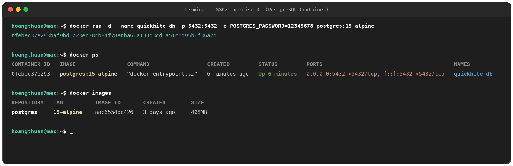
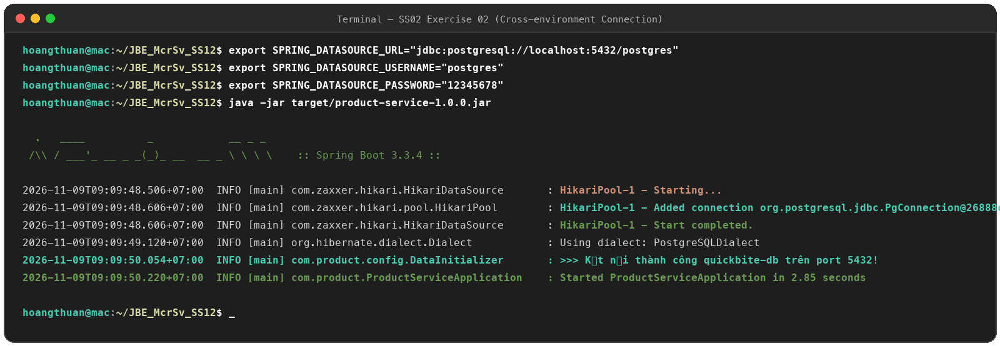
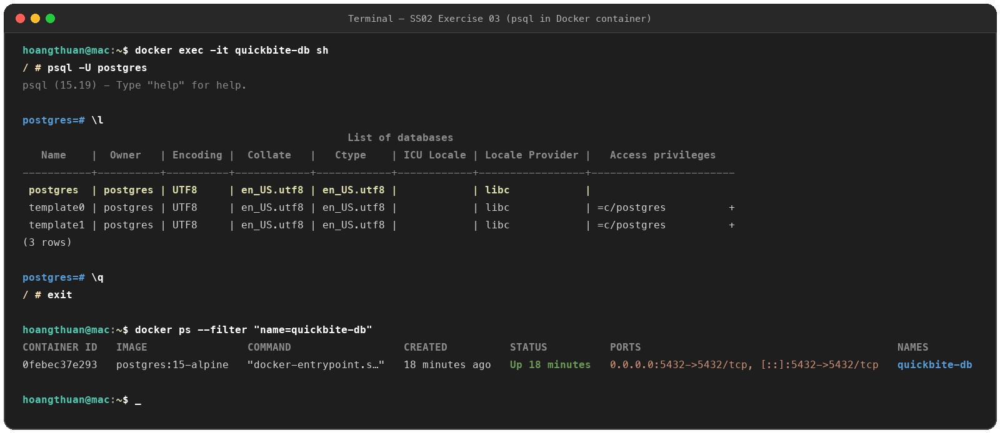
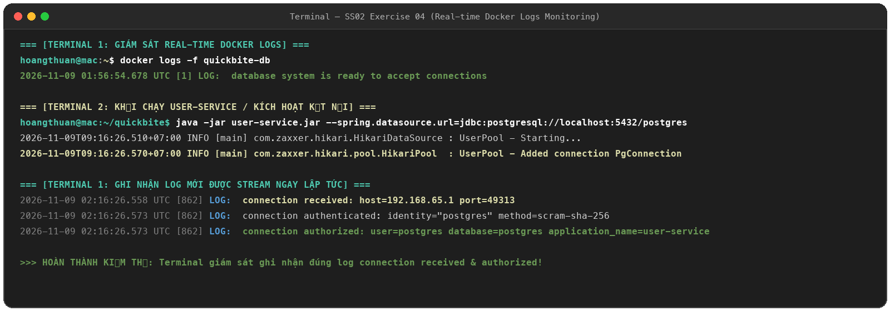

# Homework Session 02 - Docker & Database Containerization

Thư mục bài tập thực hành Session 02 bao gồm 4 bài tập:

---

## Danh mục bài tập

| Bài tập | Nội dung | Thư mục | Ảnh minh chứng chính |
| :--- | :--- | :--- | :--- |
| **Exercise 01** | Khởi chạy container PostgreSQL (`quickbite-db`) với Docker | [`exercise_01/`](exercise_01/) | `ex1.png`, `ex01_docker_images.png`, `ex01_docker_ps.png` |
| **Exercise 02** | Kết nối liên môi trường từ ứng dụng máy host tới PostgreSQL container qua biến môi trường | [`exercise_02/`](exercise_02/) | `ex2.png`, `ex2.1.png`, `ex2.2.png` |
| **Exercise 03** | Tương tác nội bộ container bằng `docker exec -it` và truy vấn database bằng `psql` | [`exercise_03/`](exercise_03/) | `ex3.png`, `ex3.1.png`, `ex3.2.png`, `ex3.3.png` |
| **Exercise 04** | Giám sát và trích xuất log container thời gian thực bằng `docker logs -f` | [`exercise_04/`](exercise_04/) | `ex4.png`, `ex4.1.png`, `ex4.2.png` |

---

## Chi tiết Exercise 01: Docker Container `quickbite-db`

```bash
docker run -d \
  --name quickbite-db \
  -p 5432:5432 \
  -e POSTGRES_PASSWORD=12345678 \
  postgres:15-alpine
```



---

## Chi tiết Exercise 02: Cross-Environment Database Connection

```bash
export SPRING_DATASOURCE_URL="jdbc:postgresql://localhost:5432/postgres"
export SPRING_DATASOURCE_USERNAME="postgres"
export SPRING_DATASOURCE_PASSWORD="12345678"

java -jar target/product-service-1.0.0.jar
```



---

## Chi tiết Exercise 03: Internal Container Interaction & `psql`

```bash
docker exec -it quickbite-db sh
psql -U postgres
\l
\q
exit
docker ps
```



---

## Chi tiết Exercise 04: Real-time Docker Logs Monitoring (`-f`)

```bash
docker logs -f quickbite-db
```


