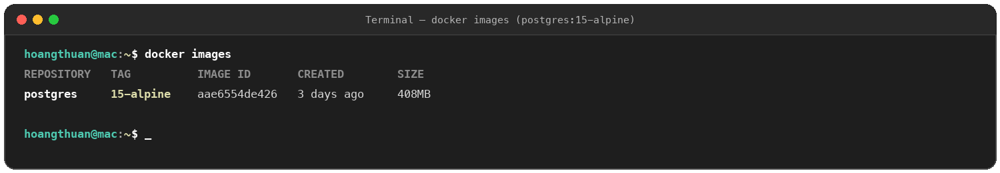
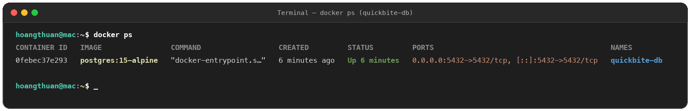
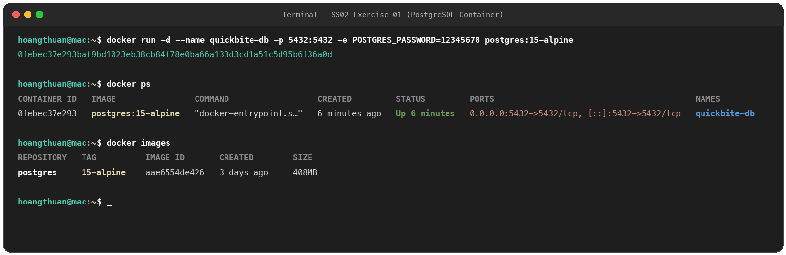

# Exercise 01: Khởi Chạy Container Cơ Sở Dữ Liệu PostgreSQL (quickbite-db)

## 1. Mục tiêu
- Khởi chạy thành công một container dịch vụ chạy ngầm sử dụng cờ detached mode (`-d`).
- Cấu hình chính xác ánh xạ cổng mạng (`-p`) và định danh (`--name`) cho container cơ sở dữ liệu `quickbite-db`.
- Truyền biến môi trường mật khẩu quản trị (`POSTGRES_PASSWORD=12345678`).

---

## 2. Câu lệnh thực thi

```bash
docker run -d \
  --name quickbite-db \
  -p 5432:5432 \
  -e POSTGRES_PASSWORD=12345678 \
  postgres:15-alpine
```

---

## 3. Ảnh minh chứng kết quả (Proofs)

### a. Danh sách Image (`docker images`)
Hiển thị image `postgres` với tag `15-alpine`:


### b. Trạng thái Container (`docker ps`)
Hiển thị container `quickbite-db`, trạng thái `Up`, cổng `0.0.0.0:5432->5432/tcp`:


### c. Quy trình thực hiện đầy đủ

