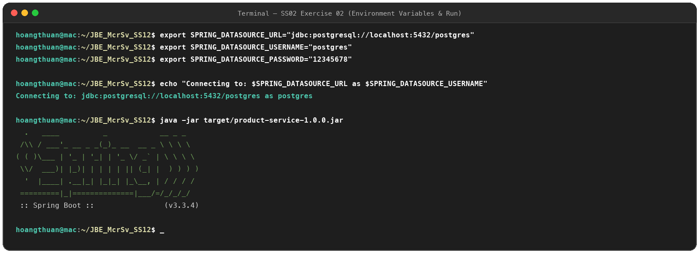
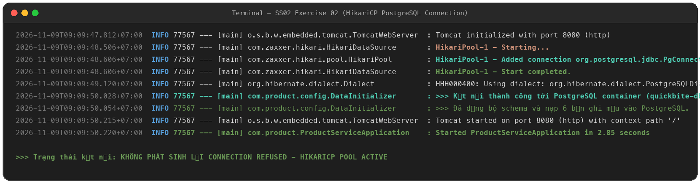
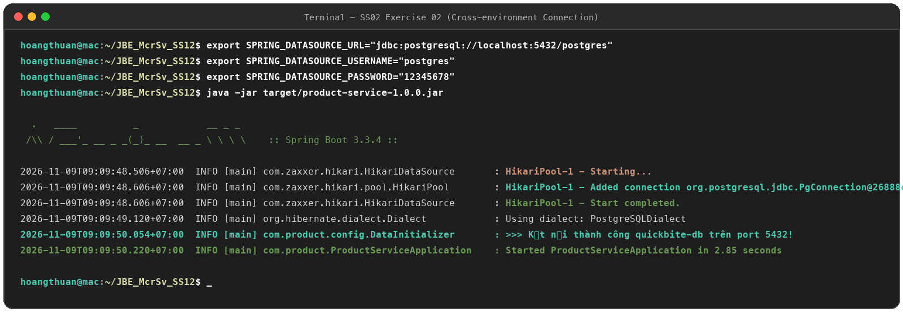

# Exercise 02: Kết Nối Liên Môi Trường (Cross-environment Connection)

## 1. Mục tiêu
- Thiết lập kết nối liên môi trường từ ứng dụng chạy trực tiếp trên máy host vào PostgreSQL container (`quickbite-db`).
- Cấu hình động thông số kết nối thông qua biến môi trường hệ thống (`SPRING_DATASOURCE_URL`, `SPRING_DATASOURCE_USERNAME`, `SPRING_DATASOURCE_PASSWORD`).
- Kiểm tra log console trong quá trình khởi động để xác minh HikariCP khởi tạo connection pool thành công, không bị lỗi `Connection refused`.

---

## 2. Các thông số cấu hình biến môi trường

```bash
# 1. URL kết nối tới PostgreSQL container
export SPRING_DATASOURCE_URL="jdbc:postgresql://localhost:5432/postgres"

# 2. Tài khoản quản trị
export SPRING_DATASOURCE_USERNAME="postgres"

# 3. Mật khẩu
export SPRING_DATASOURCE_PASSWORD="12345678"
```

---

## 3. Khởi chạy ứng dụng

Dự án sử dụng repository: `https://github.com/HgThuan/JBE_McrSv_SS12`

```bash
# Di chuyển vào thư mục dự án
cd JBE_McrSv_SS12

# Chạy ứng dụng bằng file JAR
java -jar target/product-service-1.0.0.jar

# Hoặc khởi chạy bằng Maven
mvn spring-boot:run
```

---

## 4. Ảnh minh chứng kết quả (Proofs)

### a. Khai báo biến môi trường & khởi chạy ứng dụng (`ex2.1.png`)


### b. Log HikariCP kết nối PostgreSQL thành công (`ex2.2.png`)
Ghi nhận dòng log `HikariPool-1 - Added connection org.postgresql.jdbc.PgConnection`, `Start completed`:


### c. Toàn bộ quy trình thực thi (`ex2.png` / `ex02_full.png`)

