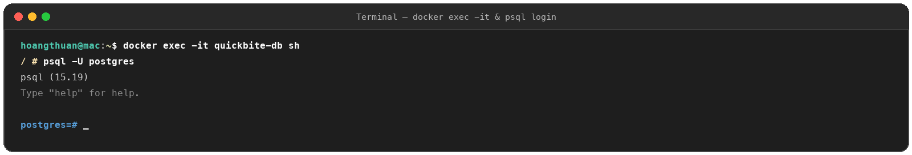
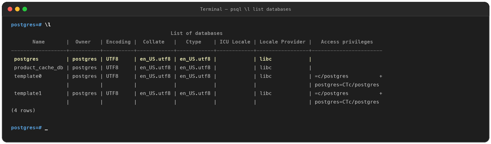
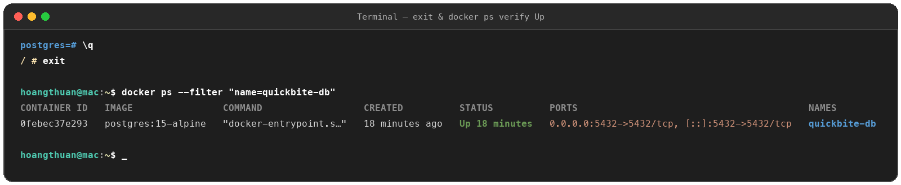
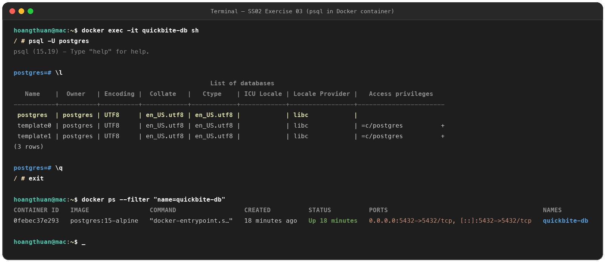

# Exercise 03: Tương Tác Nội Bộ Container & Truy Vấn Trạng Thái CSDL

## 1. Mục tiêu
- Sử dụng thành thạo lệnh `docker exec -it` để truy cập vào shell bên trong một container đang hoạt động (`quickbite-db`).
- Vận hành công cụ dòng lệnh nội bộ `psql` của PostgreSQL dưới tài khoản `postgres` để truy vấn trạng thái.
- Thoát an toàn khỏi `psql` (`\q`) và shell container (`exit`), đồng thời xác nhận container vẫn duy trì trạng thái hoạt động (`Up`) qua lệnh `docker ps`.

---

## 2. Quy trình thực hiện

### Bước 1: Mở shell tương tác vào container
Do image sử dụng nền Alpine Linux (`postgres:15-alpine`), shell tương tác mặc định là `sh`:

```bash
docker exec -it quickbite-db sh
```

### Bước 2: Đăng nhập vào trình quản trị `psql`
Tại dấu nhắc shell của container (`/ # `), đăng nhập bằng user `postgres`:

```bash
psql -U postgres
```

### Bước 3: Liệt kê danh sách các cơ sở dữ liệu
Tại dấu nhắc `postgres=# `, chạy lệnh meta-command:

```text
\l
```

*Kết quả:* Bảng danh sách các database (`postgres`, `template0`, `template1`...) được hiển thị rõ ràng.

### Bước 4: Thoát khỏi `psql` và container
* Thoát `psql`: gõ `\q` và nhấn Enter.
* Thoát khỏi container về máy host: gõ `exit` và nhấn Enter.

### Bước 5: Kiểm tra trạng thái container
Trên terminal máy host:

```bash
docker ps --filter "name=quickbite-db"
```

*Kết quả mong đợi:* Container `quickbite-db` vẫn ở trạng thái `Up` (không bị dừng lại khi thoát khỏi shell).

---

## 3. Ảnh minh chứng kết quả (Proofs)

### a. Mở shell & đăng nhập `psql` (`ex3.1.png`)


### b. Danh sách database với lệnh `\l` (`ex3.2.png`)


### c. Thoát container & kiểm tra `docker ps` xác nhận container vẫn `Up` (`ex3.3.png`)


### d. Toàn bộ chu trình thao tác (`ex3.png` / `ex03_full.png`)

