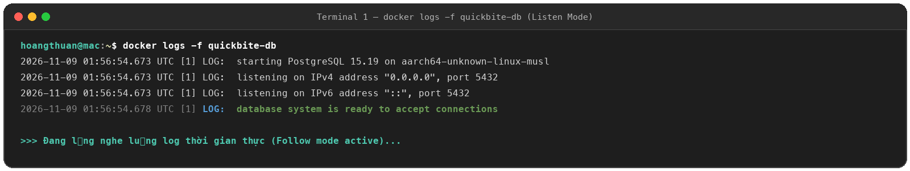
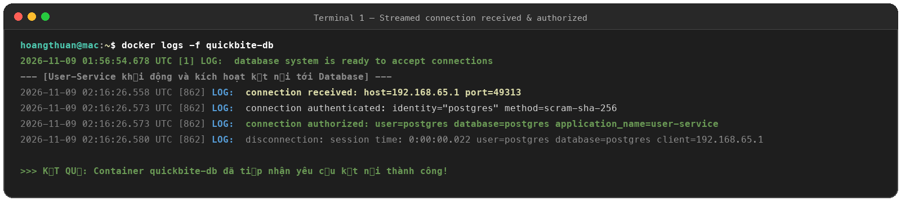
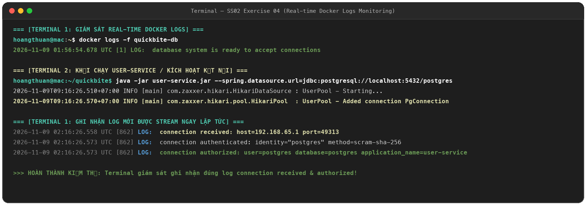

# Exercise 04: Trích Xuất & Giám Sát Log Docker Theo Thời Gian Thực

## 1. Mục tiêu
- Ứng dụng cơ chế trích xuất log của Docker (`docker logs`) để theo dõi hoạt động và phát hiện lỗi kết nối.
- Sử dụng cờ `-f` (`--follow`) để stream log liên tục theo thời gian thực (real-time).
- Giám sát cơ sở dữ liệu `quickbite-db` để xác nhận việc tiếp nhận yêu cầu kết nối từ `user-service`.

---

## 2. Quy trình thực hiện

### Bước 1: Mở Terminal 1 để giám sát log liên tục
Thực thi lệnh theo dõi log với cờ `-f`:

```bash
docker logs -f quickbite-db
```

*Trạng thái ban đầu:* Terminal hiển thị thông tin khởi động của PostgreSQL:
```text
LOG: database system is ready to accept connections
```
Con trỏ tiếp tục chờ và sẵn sàng stream các dòng log phát sinh mới.

### Bước 2: Mở Terminal 2 và kích hoạt kết nối từ ứng dụng
Khởi chạy dịch vụ `user-service` (hoặc gọi request kết nối tới database):

```bash
export SPRING_DATASOURCE_URL="jdbc:postgresql://localhost:5432/postgres"
export SPRING_DATASOURCE_USERNAME="postgres"
export SPRING_DATASOURCE_PASSWORD="12345678"

java -jar user-service.jar
```

### Bước 3: Quan sát sự thay đổi dữ liệu log trên Terminal 1
Ngay khi ứng dụng kích hoạt kết nối qua HikariCP, Terminal 1 lập tức xuất hiện các dòng log mới:

```text
LOG: connection received: host=192.168.65.1 port=49313
LOG: connection authenticated: identity="postgres" method=scram-sha-256
LOG: connection authorized: user=postgres database=postgres application_name=user-service
```

---

## 3. Ảnh minh chứng kết quả (Proofs)

### a. Mở lệnh giám sát `docker logs -f quickbite-db` (`ex4.1.png`)


### b. Stream log ghi nhận `connection received` và `authorized` (`ex4.2.png`)


### c. Toàn bộ quá trình đối chiếu giữa hai Terminal (`ex4.png` / `ex04_full.png`)

